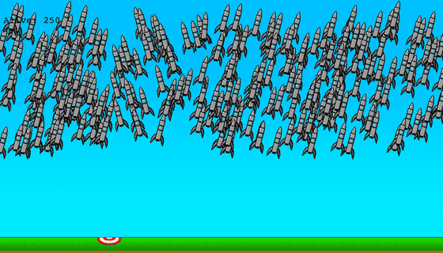

# Rocket Landing NEAT

A rocket landing game I made in Python with pygame, and an AI that tries to learn to land it with NEAT.



*The saved best network flying 250 rockets from random spots, three rounds in real time. It never learnt to land. The rockets turn towards the target and fly into it, like missiles, and most come down short.*

I made it in August 2024, straight after following a tutorial for [Flappy Bird](https://github.com/nourbashoush/flappy-bird-neat), to see if I could make one on my own: my own game, physics, sprites and scoring. The idea came from Code Bullet's [A.I. Learns to DRIVE](https://www.youtube.com/watch?v=r428O_CMcpI).

- **The write-up** of every input, reward and network shape I tried is in [NEAT/README.md](NEAT/README.md).
- **The story** is on my site: [I tried to teach rockets to land, and got missiles](https://nour.page/posts/rocket-landing/).

## Run it

```
pip install -r requirements.txt
```

Run everything from this folder, since it loads the images and sounds from here.

- **Fly it yourself:** `python main_MAIN.py`. Space for the engine, ← and → to turn, R to start again.
- **Train it:** `python NEAT/main_NEAT.py`. 250 rockets a generation, for up to 1,000 generations. While it runs, ↑ and ↓ change the speed, I shows the fitness graph and right Shift ends the round. Closing the window saves the best rocket so far to `early_stop_winner.pkl`.
- **Draw the best network:** `python NEAT/unpickle.py` draws the saved best rocket's network from `NEAT/best-genome.pkl`.

The NEAT settings are in `NEAT/config-feedforward.txt`, and the scoring is in `components/constants.py`.
